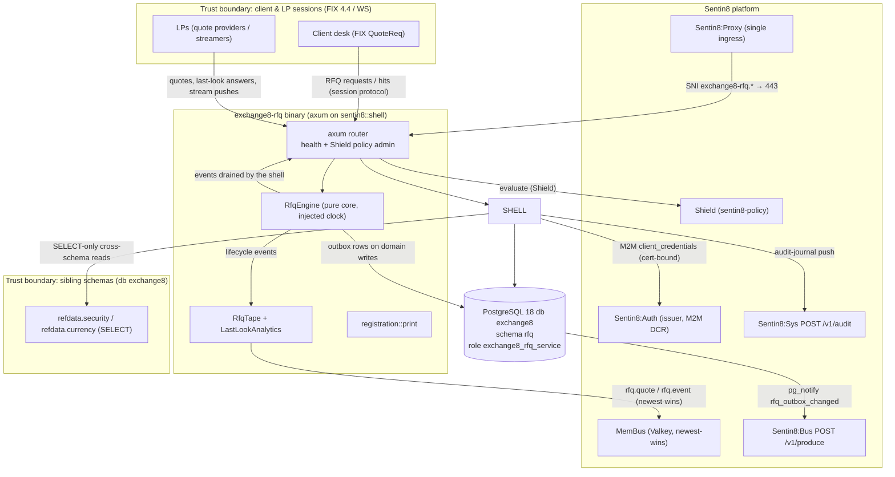

# README.md: Exchange8:RFQ

## 1. Summary

Exchange8:RFQ is the **quote-driven trading** service of the exchange8 vertical: the
Request-For-Quote engine for FX - clients broadcast an RFQ (pair, side, qty,
tenor), all entitled liquidity providers (LPs) respond with two-way prices
inside a bounded quote window, the client hits one quote, and the LP's
**last look** may accept or reject inside its own bounded window. Beyond the
RFQ flow the engine operates the **streaming-quote** side channel (LPs push
two-way prices continuously; a hit binds the newest still-valid,
non-withdrawn quote), projects an **anonymized public tape** of RFQ
activity, and maintains the per-LP **last-look scorecard**. It is a Rust
axum binary built on the platform `sentin8::shell` crate (Sentin8 Shell):
global allocator, graceful drain.

## 2. Motivation

- Institutional FX liquidity is split between the central-limit order book
  (served by Exchange8:ME) and **bilateral quote-driven dealing** at large or
  illiquid sizes. The RFQ model needs an engine with fundamentally different
  timing semantics: response windows measured in hundreds of milliseconds,
  per-quote validity, and per-LP last look - none of which fit a price-time
  order book.
- **Fair routing** is a market-integrity requirement: the request fans out to
  all entitled LPs at once; no LP may see the request earlier. Engine receive
  timestamps (not LP-supplied ones) are authoritative.
- **Late quotes must never bind** - a response arriving after the quote
  window is recorded for audit but is never shown to the client and never
  wins. This keeps the client's view honest under asynchronous LP load.
- **Last look** is asymmetric by market convention: an LP may reject the
  deal inside its bounded window (the client's hit dies with `rfq:rejected`),
  but an LP that accepts late still fills at the quoted price - the venue
  counts and measures both behaviors rather than ignoring them.
- **RFQ liquidity is sensitive information.** A public feed of raw events
  would leak which LP quoted which price to which client - the tape is an
  anonymized projection: pair, two-way price, dealt size; no identities,
  no one-sided quotes.
- LP quote behaviour needs **measurement to be governable**: quotes sent,
  rejects by reason and late last-look answers are the scorecard inputs the
  venue uses to keep RFQ entitlement honest.

## 3. Architecture & High-Level Design

The service is a Sentin8 Shell binary (`exchange8:rfq`, DSN prefix
`EXCHANGE8_RFQ`). The binary wires the HTTP/TLS surface (`GET /v1/health`,
`/openapi.json`, the Shield policy-admin API) and publishes on the platform
MemBus (`sentin8::membus::ServiceBus`, Valkey-backed, newest-wins): family
`rfq.quote` for streaming LP quotes (private to entitled sessions) and
family `rfq.event` for the anonymized tape. The domain logic lives in a
**pure engine** - the clock is injected, the shell owns all sockets and
transport; this separation is what makes the conformance suite and unit
tests deterministic.

| Module | Responsibility |
|---|---|
| `main.rs` | Shell assembly: `Sentin8Shell::new("exchange8:rfq", "EXCHANGE8_RFQ")`, MemBus connect, Shield policy-admin router mount, `HasPolicyAdmin` impl (admin surface + request path share the same policy cache) |
| `engine.rs` | `RfqEngine` pure core: RFQ state machine, quote windows + late handling, hit binding at the quoted deal leg, last-look parking/accept/reject, streaming quote books, trade-id counter, reject counters, sweep |
| `conformance.rs` | Five engine conformance scenarios (quote-window expiry, late-quote non-binding, last-look binding incl. late accepts, last-look reject, stream binding) driven on a scripted clock |
| `tape.rs` | `RfqTape` anonymized public feed projection + `LastLookAnalytics` per-LP scorecard (private, admin-scoped) |
| `registration.rs` | Self-registration: Shield scope-mirror policy set (`scope-mirror`, enforced), PG role, admin scopes, error codes, RFW admin pages, M2M DCR grants, SQL init migration |
| `sql/init.sql` | Schema `rfq`: FX pair/tenor master, RFQ lifecycle, quotes, rejects, streaming quotes, currency exposure + `rfq.outbox` + `rfq.audit_journal`, all RLS FORCE'd |

Persistence follows the platform DBX pattern: **every domain write inserts a
`rfq.outbox` row in the same transaction**; the shell relay pushes it to
Sentin8:Bus `POST /v1/produce` (`idempotency_key` = outbox row id), and the
audit pusher drains `rfq.audit_journal` to Sentin8:Sys `POST /v1/audit`
(`sentin8:sys:audit:write`). Schema-per-service: database `exchange8`,
schema `rfq`, role `exchange8_rfq_service` (no `BYPASSRLS`), with declared
SELECT-only cross-schema grants to `refdata.security` and `refdata.currency`.

## 4. Key Traits and Data Structures

Pure concepts - how the model fits together (no signatures):

- **RFQ lifecycle** - a state machine
  `Open → Quoting → Quoted → Traded | Expired | Rejected`. A request with no
  entitled LP expires immediately; a quote lifts the RFQ to `Quoted`; the
  client's hit transitions to `Traded`; a window without answers expires; a
  last-look reject terminates in `Rejected`. Each RFQ carries its quote
  window (default 500 ms), its accumulated LP quotes and its winning LP.
- **Quote collection (`LpQuote`)** - each LP response records the two-way
  price, size, the LP-declared validity (capped by the engine on ingest) and
  the **engine receive time**. The `late` flag is authoritative for
  visibility: late quotes are recorded, surfaced as audit-only events and
  never shown to the client or marked as winners.
- **Fair routing** - on request the engine expands the entitled LP set
  (`rfq_provider` LPs whose pair entitlement covers the RFQ's pair) and
  emits one broadcast event routing to all of them simultaneously; per-LP
  config (`LpConfig`) also carries the last-look window and streaming
  capability.
- **Hit binding** - a hit names an LP and a deal price. The engine binds the
  LP's newest non-late quote, resolves the dealt leg from the client's side
  (buy → LP ask, sell → LP bid) and requires the hit price to equal it
  exactly; a hit past the quote's validity expires the RFQ. Prices are never
  invented or averaged - the deal happens at the quoted level.
- **Last look (`PendingHit`)** - when the hit LP has a last-look window the
  hit is parked with a deadline. An accept (even **late**, past the LP's
  deadline) trades at the quoted price and is flagged for the scorecard; a
  reject inside the window produces `rfq:rejected`, no trade, and a
  per-(LP, reason) counter row. The sweep binds pending hits whose deadline
  passed without an answer.
- **Streaming quotes (`StreamQuote`)** - a per-(LP, pair) live book where a
  new push replaces the previous quote (**newest binds**); withdrawal marks
  the quote dead. A streaming hit reuses the same trade-id source and emits
  the trade event with `rfq_id = 0` (no RFQ behind it).
- **Tape (`RfqTape`)** - an append-only anonymized projection: sequence,
  engine timestamp, and one of `RfqBroadcast` (pair + size, deliberately no
  side), `QuoteLanded` (two-way only), `Traded`, `Expired`. Rejections,
  late quotes and one-sided quotes are **not tapeable**.
- **Last-look analytics (`LastLookAnalytics`)** - per-LP counters
  (hits parked, accepts, rejects by reason, late accepts) with a derived
  reject rate, sorted deterministically for snapshotting.

## 5. Rationale, Trade-offs, and Alternatives

- **Pure engine with injected clock** over a socket-coupled engine. The RFQ
  rules are all about microseconds: quote windows, validity, last-look
  deadlines. Keeping the engine free of I/O lets the conformance module and
  unit tests replay scenarios on a scripted clock with zero nondeterminism.
  A shell/clock-coupled engine was rejected: every test would race wall time
  and a regression could only be reproduced live.
- **Engine receive-time authority** over trusting LP timestamps: LP-supplied
  times are advisory (client-side clock skew is a fairness attack); the
  engine stamps `received_us` on ingest. The cost is trusting the engine's
  single clock - accepted, because the engine is the serialization point.
- **Anonymized tape projection** over publishing raw lifecycle events:
  raw events carry LP identity and reject reasons, which enable
  front-running and quote sniping. The projection drops identity-bearing or
  one-sided events by construction, so no leak can be introduced by a
  consumer bug.
- **MemBus (newest-wins) for quotes, Sentin8:Bus (durable) for lifecycle**:
  streaming quotes are valueless once superseded (a stale quote must never
  be re-delivered), while the RFQ lifecycle is an audited trading record.
  Routing quotes through the durable bus would add delivery weight without
  any use for stale prices.
- **Newest-binds streaming book (single slot per (LP, pair))** over a
  historical order book: the market convention is hit-binds-newest; keeping
  one live quote per LP/pair makes withdrawal and expiry O(1) and removes
  any stale-quote ambiguity.
- **Asymmetric last-look binding** (a late accept still fills at the quote)
  over symmetric expiry: the client dealt on a shown price and must get
  price certainty; the LP's late answer is measured on the scorecard
  instead, which preserves the venue's pricing integrity without letting
  LPs dodge hits by stalling.
- **In-process tokio workers** (sweep, relay, audit pusher as shell/shell
  tasks) over separate binaries: the RFQ hot path is single-digit
  milliseconds; a shared process avoids cross-service hop latency and keeps
  the allocator and drain story uniform (master design §11.1).

## 6. Internal Implementation & Invariants (Private Design)

- The engine is a single in-memory state machine (`rfqs`, `lps`, `streams`,
  `pending_hits`, `reject_counters`); events accumulate in an internal log
  the shell drains (`take_events`). No tokio primitives inside the core -
  the shell turns events into bus/membus/DB writes.
- **Sweep** (`sweep(now_us)`) expires RFQs still in
  `Open`/`Quoting` past their quote window plus a 100 ms grace
  (`VALID_GRACE_US`), then binds pending last-look hits past their deadline.
- Lateness is decided by the session layer relative to the RFQ's request
  time; the engine trusts the caller-set `late` flag, records the quote
  anyway, and enforces non-visibility and non-binding for it.
- LP-declared quote validity is bounded at ingest to the engine receipt
  time plus `MAX_VALID_WINDOW_US` (5 s) - an LP cannot park an indefinite
  validity to snipe later hits.
- On trade, every non-winning quote of the RFQ is flagged (persisted as
  `winning = false` on the quote rows); winning-quote attribution is
  preserved per RFQ.
- Hit price matching is **exact equality** with the quote's deal leg - there
  is no tolerance band, because a mismatch is either a stale or an edited
  price and both are market abuse vectors.
- Invariants (verified by the unit tests and the conformance module):
  1. A quote for an unknown or non-`Quoting` RFQ is dropped, never quoted.
  2. A late quote produces `LateQuote` (audit), no `Quoted` event, and can
     never be hit.
  3. A hit whose price does not exactly match the quoted deal leg is
     ignored; the RFQ stays `Quoted`.
  4. A hit past the quote's `valid_until` expires the RFQ; no hit wins.
  5. A last-look accept past the deadline still trades (asymmetric), and is
     counted `late_last_look` for the LP scorecard.
  6. Withdrawn or expired streaming quotes, and one-sided quotes for the
     dealt leg, bind nothing.
  7. Streaming trades are emitted with `rfq_id = 0` and draw from the same
     trade-id counter as RFQ trades.
- On the persistence side every tenant table is RLS `FORCE`d with the
  standard policy set (`sentin8_context_initialized()` AND
  `env_id = sentin8_current_env_id()`); context is set on the same
  connection/transaction as the queries; the outbox + journal ride the same
  transaction as the domain write (see `DESIGN.md` §5).

## 7. Unresolved Questions / Future Designs

- The FIX 4.4 QuoteReq/WS session transports, the bus consumers/members and
  the sweep timer are not wired in this binary yet - the HTTP router carries
  health + Shield policy admin only, and no domain handler mounts exist.
  Runtime wiring lands with the router/handler pass mirroring the sibling
  services.
- RFW admin pages (`rfqs`, `pairs`, `lp-sessions`) are registered with the
  platform admin shell; their UI/data handlers
  (`/v1/admin/ui/{page}`, `/v1/admin/{resource}`) are not mounted.
- `rfq.outbox` emission from the engine (event types per lifecycle event +
  stream families) is designed by the DBX pattern but not yet written by
  any handler path.
- `rfq_id`/trade-id batch leases from the platform sequence facility - the
  engine takes injected counters today; the lease-at-startup wiring is the
  vertical id-substrate pattern (data-model design §2a) and lands with the
  runtime wiring.
- The `rfq.currency_exposure` update path (who shifts net positions on
  dealt trades, and the interplay with Exchange8:Risk's limit checks) is a
  risk-design decision; only the table and the limit columns exist today.
- The tape SSE publisher surface (session-entitled consumers) and the
  client-visible quote stream API ride the MD/VFeeds surface design; their
  exact endpoint contract for RFQ is not fixed.
- Pair `quote_type` routing (`clob` / `rfq` / `stream` / `clob+rfq`) - the
  engine is pair-agnostic today; the router that splits client flows between
  Exchange8:ME (CLOB) and this engine per pair is outstanding.

---

**Design attribution:** exchange8:rfq and its underlying concepts were designed by Hamid Jahanzad <Hamid@Jahanzad.com>.
